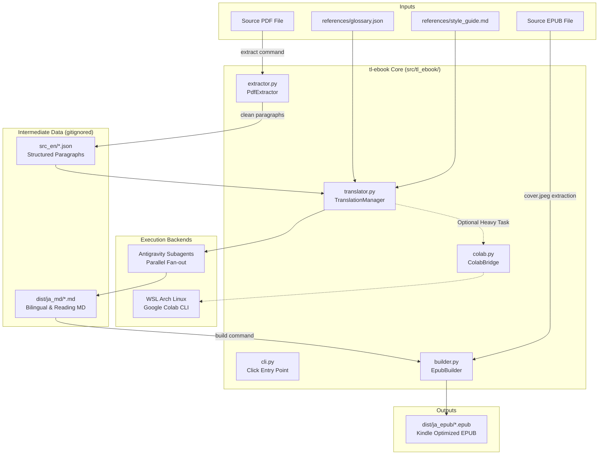

# システムアーキテクチャ仕様書 (ARCHITECTURE.md)

本ドキュメントは、**tl-ebook** の全体アーキテクチャ、各コンポーネントの責務、データフロー、および設計原則を定義します。

---

## 1. システム全体図



---

## 2. コアコンポーネントの責務

| モジュール | クラス / 機能 | 責務 |
|---|---|---|
| `cli.py` | `main`, `toc`, `extract`, `build`, `colab-status` | ユーザーおよびエージェント向けのCLIインターフェース。引数パース、進捗表示（`rich`）、各モジュールのオーケストレーション。 |
| `extractor.py` | `PdfExtractor`, `Paragraph` | PDF/EPUBから見出し・段落・テキストを欠損なく抽出。見開きページの余白オフセット自動補正、行末ハイフネーション修復。 |
| `translator.py` | `TranslationManager`, `TranslationItem` | 用語集（`glossary.json`）とスタイルガイドのロード、章ごとの英日段落データ構造の保持、Markdown生成。 |
| `builder.py` | `EpubBuilder` | 翻訳済みMarkdownからKindle対応EPUBを生成。表紙画像、CSS、目次ナビゲーション、EPUB2/3ハイブリッドメタデータの付与。 |
| `colab.py` | `ColabBridge` | WindowsからWSL（Arch Linux）上の `google colab cli` をサブプロセス実行し、クラウドセッションの監視・コード実行を担当。 |

---

## 3. 主要データフロー

```text
[生書籍ファイル: PDF/EPUB]
       │
       ▼  `tl-ebook extract <file> -o src_en/`
[章別構造化JSON: src_en/*.json]  (段落ID, 英文テキスト)
       │
       ▼  サブエージェント並列翻訳（スタイルガイド・用語集適用）
[翻訳Markdown: dist/ja_md/*.md]  (日本語訳全文 + 日英対訳詳細)
       │
       ▼  `tl-ebook build --cover <file>`
[完成版EPUB: dist/ja_epub/*.epub] (Kindle対応、表紙・目次内包)
```

---

## 4. 設計原則

1. **Git管理のクリーン性と著作権保護**:
   - 著作物である元のPDF/EPUB、抽出された英文JSON（`src_en/`）、生成されたEPUB/Markdown（`dist/`）は絶対にコミットしない（`.gitignore` で完全除外）。
   - リポジトリには「ツールのソースコード」と「汎用テンプレート・スタイルガイド」のみを配置する。
2. **決定論的かつ再現性の高い環境 (`uv`)**:
   - パッケージの追加や更新はすべて `uv add` を使用し、`uv.lock` で固定する。
   - 外部環境依存（OSによるパスの違い、文字コード）を極小化する（すべて UTF-8 明示、`pathlib.Path` 利用）。
3. **人間とAIエージェントの双方向可観測性**:
   - 翻訳データはJSONだけでなく、人間もチェックしやすい `dist/ja_md/*.md`（日英対訳テーブル付き）として残す。
   - EPUBビルダーは、Markdown内の `## 日本語訳全文` セクションのみを自動抽出し、リーダー端末ではノイズのない快適な読書体験を提供する。
